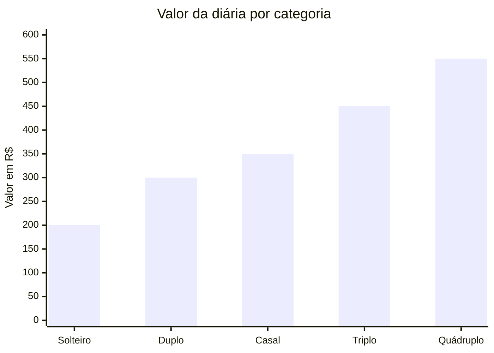
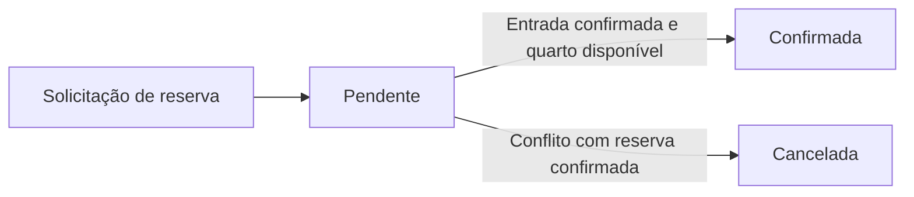
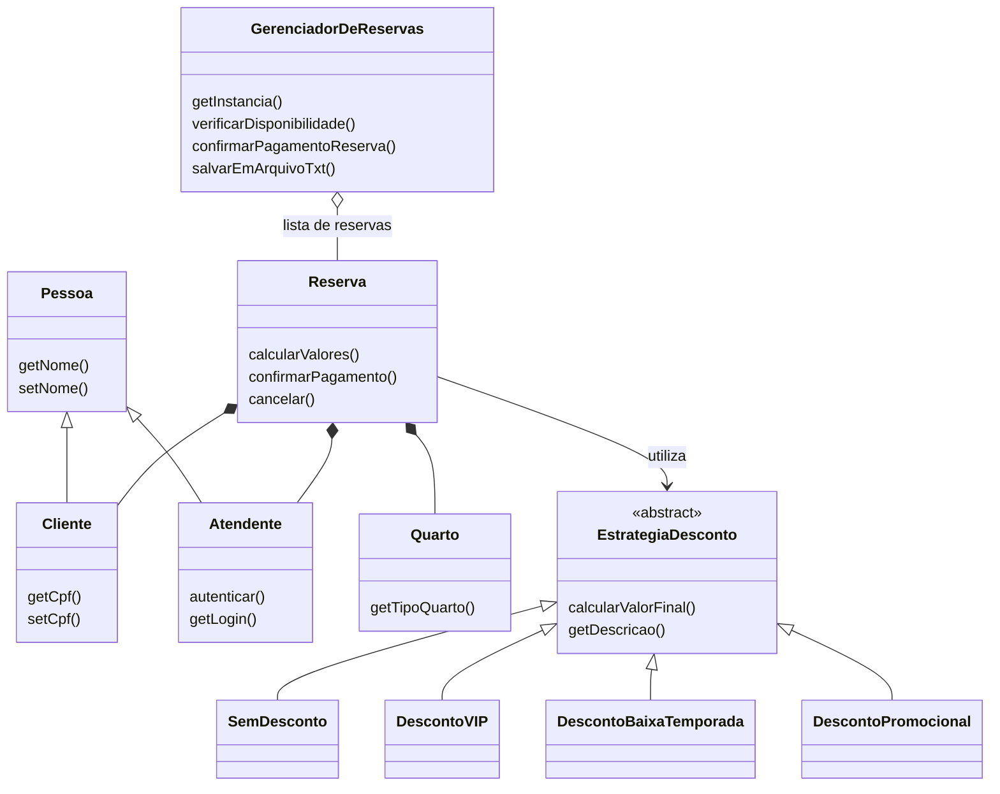
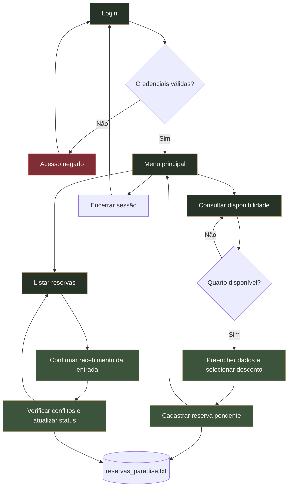
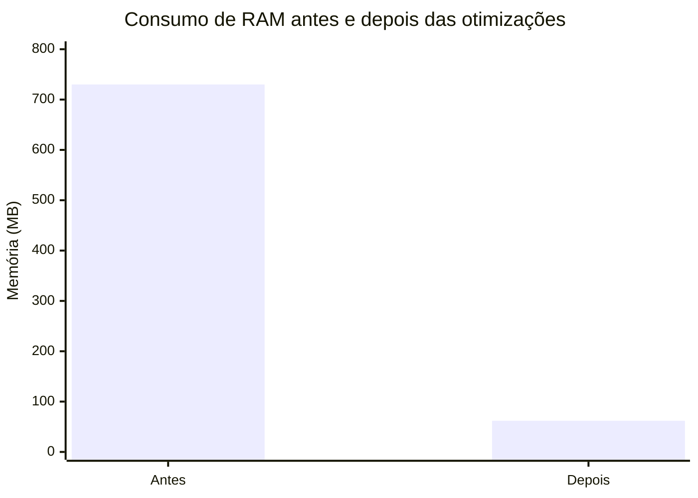

# Hotel Paradise — Sistema de Reservas


Sistema desktop desenvolvido em C++ com Qt Widgets para centralizar o atendimento e o gerenciamento de reservas da Rede de Hotéis Paradise. O projeto foi realizado na disciplina de **Programação Orientada a Objetos**, aplicando conceitos de POO, padrões de projeto, interface gráfica e persistência de dados.

> **3 unidades** · **5 categorias de quartos** · **15 quartos na rede** · **4 políticas de desconto** · **2 padrões de projeto**

**Navegação:** [Funcionalidades](#funcionalidades) · [Regras de negócio](#regras-de-negócio) · [Arquitetura](#arquitetura-e-orientação-a-objetos) · [Compilação](#como-compilar-e-executar) · [Otimizações](#otimizações) · [Autores](#autores)

## Sobre o projeto

O sistema permite que atendentes autenticados consultem a disponibilidade de quartos, cadastrem reservas, apliquem descontos e confirmem o recebimento de pagamentos em três unidades da rede, localizadas no Ceará:

- Jericoacoara
- Canoa Quebrada
- Cumbuco

Cada unidade possui um quarto de cada categoria. A disponibilidade é verificada durante todo o período da hospedagem, evitando conflitos entre reservas confirmadas.

## Funcionalidades

- Autenticação de atendentes, com mensagens de acesso permitido e negado.
- Menu principal com identificação do atendente autenticado.
- Consulta de disponibilidade por hotel, tipo de quarto, check-in e número de diárias.
- Agendamento com check-in em até 12 meses.
- Cadastro dos dados do cliente durante a realização da reserva, com verificação de CPF de 11 dígitos.
- Cálculo automático do valor da hospedagem, desconto e entrada de 1/3 do valor total.
- Listagem de reservas com ordenação cronológica, descontos e status.
- Confirmação do recebimento da entrada e cancelamento automático de solicitações conflitantes.
- Salvamento e recuperação das reservas em arquivo de texto.
- Encerramento da sessão e retorno à tela de login.

## Regras de negócio

### Tipos de quarto e valores das diárias

| Categoria | Valor da diária |
| --- | ---: |
| Solteiro | R$ 200,00 |
| Duplo | R$ 300,00 |
| Casal | R$ 350,00 |
| Triplo | R$ 450,00 |
| Quádruplo | R$ 550,00 |

#### Comparativo das diárias



### Políticas de desconto

| Estratégia | Desconto |
| --- | ---: |
| Sem desconto | 0% |
| Cliente VIP | 10% |
| Baixa temporada | 20% |
| Promocional | 15% |

O valor total é calculado multiplicando a diária pela quantidade de diárias e aplicando a estratégia de desconto selecionada. A entrada corresponde a um terço do valor final.

### Ciclo de vida da reserva



- **Pendente:** solicitação cadastrada, aguardando confirmação do pagamento. Não bloqueia o quarto.
- **Confirmada:** entrada recebida e registrada pelo atendente. Bloqueia o quarto durante o período da hospedagem.
- **Cancelada:** solicitação pendente que perdeu a disponibilidade por conflito com uma reserva confirmada.

A verificação de conflitos considera o mesmo hotel, o mesmo tipo de quarto e a sobreposição entre os intervalos de hospedagem. O dia do check-out não é considerado ocupado pela reserva que termina naquele dia.

## Arquitetura e orientação a objetos

| Classe | Responsabilidade |
| --- | --- |
| `Pessoa` | Armazena os dados comuns de identificação. |
| `Cliente` | Herda de `Pessoa` e acrescenta o CPF. |
| `Atendente` | Herda de `Pessoa` e implementa a autenticação. |
| `Quarto` | Representa a categoria e a diária do quarto. |
| `Reserva` | Reúne cliente, atendente, quarto, hospedagem, valores, desconto e status. |
| `GerenciadorDeReservas` | Centraliza autenticação, disponibilidade, reservas e persistência. |
| `EstrategiaDesconto` | Define a interface comum para as políticas de desconto. |

O projeto utiliza **herança, encapsulamento, abstração, composição e polimorfismo**, organizando as responsabilidades entre as classes do domínio e a interface gráfica.

### Diagrama de classes do domínio

O diagrama UML simplificado destaca a herança, a composição dos objetos de `Reserva` e o uso de Strategy. As operações apresentadas são apenas as principais, não a assinatura completa de cada classe.



### Padrões de projeto

**Singleton:** aplicado à classe `GerenciadorDeReservas`, que disponibiliza sua instância compartilhada pelo método `getInstancia()`, centralizando o gerenciamento dos dados entre as telas.

**Strategy:** aplicado à classe `EstrategiaDesconto`, com as implementações `SemDesconto`, `DescontoVIP`, `DescontoBaixaTemporada` e `DescontoPromocional`. A classe `Reserva` delega o cálculo do desconto à estratégia selecionada, permitindo alterar a política de cálculo sem modificar seu método `calcularValores()`.

## Interface gráfica

| Tela | Classe |
| --- | --- |
| Login | `LoginDialog` |
| Menu principal | `MainWindow` |
| Consulta e cadastro de reservas | `TelaDisponibilidade` |
| Listagem e confirmação de pagamentos | `TelaListagem` |

A navegação utiliza `QStackedWidget` e o mecanismo de Signals & Slots do Qt. A listagem utiliza `QTableWidget`, com identificação das reservas por `Qt::UserRole`, preservando o vínculo com o registro original mesmo após a ordenação da tabela.

### Fluxo de utilização



## Persistência de dados

As reservas são armazenadas em memória utilizando `std::vector<Reserva>` e gravadas localmente no arquivo `reservas_paradise.txt`.

Na inicialização, o sistema recupera os registros e reconstrói os objetos, incluindo valores, descontos e status. Durante o salvamento, os índices são ordenados por data de check-in sem modificar a ordem original do vetor. Registros inválidos são ignorados durante o carregamento.

O arquivo é acessado por caminho relativo ao diretório de trabalho do programa. Utilize sempre o mesmo diretório de trabalho para manter o histórico das reservas.

## Tecnologias utilizadas

- C++17
- Qt 6 / Qt Widgets
- Qt Creator e Qt Designer
- CMake
- Git e GitHub
- Qt Style Sheets (QSS)

## Como compilar e executar

### Pré-requisitos

- Qt 6 com o módulo Qt Widgets.
- Qt Creator (recomendado).
- CMake e um compilador C++ compatível com o kit Qt instalado (MinGW 64-bit no Windows, por exemplo).

### Pelo Qt Creator

1. No GitHub, clique em **Code** e copie a URL HTTPS do repositório.
2. Clone o repositório com o Git ou pela opção de importação de projetos do Qt Creator.
3. Abra o arquivo `CMakeLists.txt` no Qt Creator.
4. Selecione um kit compatível com o Qt 6 instalado, como **Desktop Qt 6 MinGW 64-bit** no Windows.
5. Clique em **Configure Project**.
6. Compile o projeto com `Ctrl + B` e execute com `Ctrl + R`.

Os recursos visuais (imagens, fontes e ícones) devem estar na pasta `Resource Files`, ao lado do executável, conforme os caminhos utilizados pelo código. Se a compilação não copiar essa pasta automaticamente, copie-a manualmente.

### Distribuição no Windows

Compile o projeto na configuração **Release**. No terminal configurado para a mesma versão do Qt e o mesmo compilador usados na compilação, execute o comando abaixo na pasta de distribuição que contém o executável:

```bat
windeployqt --release --compiler-runtime HotelSystem.exe
```

Mantenha as bibliotecas e os plugins gerados pelo comando junto ao executável, além da pasta `Resource Files`. O arquivo `reservas_paradise.txt` pode ser copiado para preservar os dados existentes.

## Otimizações

- Destruição da tela de login inicial após a autenticação para liberar seus recursos.
- Limitação do cache de imagens (`QPixmapCache`) a 15 MiB.
- Redimensionamento dos logotipos com `QPixmap`.
- Desativação temporária da ordenação da tabela durante seu preenchimento.

### Comparativo do consumo de memória

Segundo os valores aproximados informados pela equipe durante o desenvolvimento, o consumo de RAM passou de **730 MB para 62 MB**, uma redução de aproximadamente **91,5%**.



| Indicador | Valor aproximado |
| --- | ---: |
| Consumo inicial | 730 MB |
| Consumo após otimizações | 62 MB |
| Redução absoluta | 668 MB |
| Redução percentual | 91,5% |

> Os números são medições informadas pela equipe, sem protocolo de benchmark documentado neste README. O consumo pode variar conforme o ambiente e o estado da aplicação.

## Autores

Desenvolvido por:

- **Jair Costa**
- **Uriel Vitor**

Universidade Tecnológica Federal do Paraná (UTFPR) — Engenharia de Computação — Programação Orientada a Objetos.

---

**Nota:** este é um projeto acadêmico. A autenticação local e o armazenamento em TXT não foram projetados para uso em produção com dados pessoais reais. Utilize dados fictícios em testes e não publique arquivos contendo informações de clientes.
